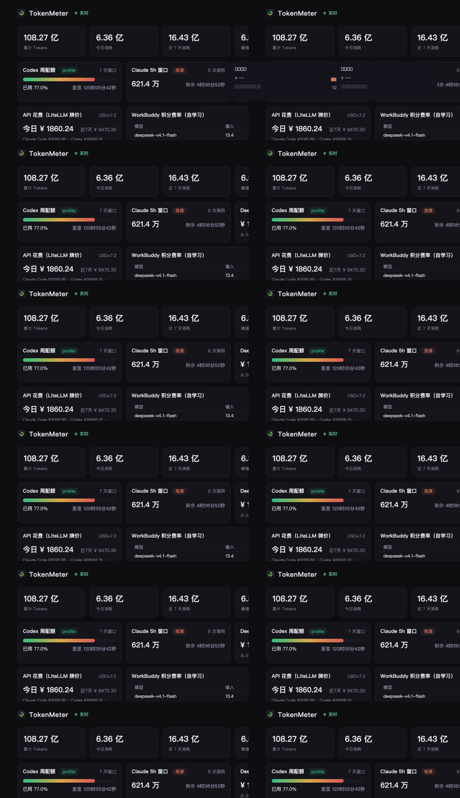

<div align="center">

# Token Watcher

**Local, real-time token usage & quota dashboard for AI coding agents.**

One resident process parses the session logs your AI coding tools already
leave on disk, normalizes them into a per-request event stream, and serves a
live dashboard: Codex-style stats, real-time quota cards, vendor balance
polling, cost estimation with reconciliation, and a macOS menu-bar capsule.
Local storage by default. The optional community leaderboard shares only
aggregate statistics after you explicitly opt in.

[](https://www.npmjs.com/package/token-watcher)
[](https://github.com/luwill/token-watcher/actions/workflows/test.yml)
[](./LICENSE)
[](#requirements)

[简体中文](./README.zh-CN.md) · English



> Screenshot is real running data (vendor balances and project names masked).

</div>

## Why Token Watcher

> **Missing Codex history?** The source now reads `.jsonl`, `.jsonl.zst`, and `.jsonl.zstd`; collector v5 rescans available compressed history. Missing dates can affect both 7-day and 30-day totals. Local recovery does not backfill past community leaderboard reports. See the [decoder requirements, date windows, and recovery guide](./docs/CODEX-COMPRESSED-HISTORY.md) (Chinese).

Most token trackers recompute a report when you ask. Token Watcher watches
the logs as they're written: FSEvents → incremental parse → SSE push, the
dashboard updates in **under a second** while your agents work. Everything is
stored as **per-request events**, not pre-aggregated buckets — so you can
drill from a day, to a session, to a single request's token curve.

Measurement limits are documented: Antigravity reads real token usage when
available and estimates older logs. Models without pricing show up as *unpriced*,
and vendor balances are **reconciled** against locally computed spend so you
can see when the estimate drifts.

| | Token Watcher | TokenTracker | ccusage | Tokscale |
|---|---|---|---|---|
| Interface | Local web dashboard + menu bar | Native apps + web | CLI reports | TUI / CLI |
| Refresh | Real-time (FSEvents + SSE, <1s) | Hook-triggered sync | Manual run | Manual run |
| Granularity | Per-request events | 30-min buckets | Daily | Daily |
| Sources | 13, incl. China stack (ccmr, dsh, Qoder, Kimi Code, WorkBuddy) | 39 | Multi-agent | Multi-agent |
| Cost | LiteLLM prices + **balance reconciliation** + credits ledger | LiteLLM estimate | Estimate | Estimate |
| Official quotas | Claude / Codex direct-read, Cursor billing CSV | 17 providers | Limited | Several |
| Telemetry | Optional, opt-in aggregate leaderboard | Opt-out | None | None |
| Install | One zero-dependency npm package (incl. universal menu-bar app) | npm + platform packages | npm | npm |

## Supported tools (13 sources)

| Tool | Data location | What you get |
|---|---|---|
| Claude Code (including local Cowork) | `~/.claude/projects` + Desktop Cowork logs | Per-message usage, cross-format dedup |
| ccmr (claude-code-model-router) | `~/.claude-gateway/projects` | Same, with real model names behind the router |
| Codex | `~/.codex/sessions` | Per-request tokens, **official quota % and resets** (5h / weekly), models incl. auto-review, tool calls |
| ZCode | `~/.zcode/cli/db/db.sqlite` | Per-request details, tool calls, **GLM Coding Plan credit windows** (5h / weekly, official API) |
| dsh (DeepSeek Harness) | `~/.dsh/sessions` | Per-request details (multi-frame zstd snapshots) |
| WorkBuddy | `~/.WorkBuddy/projects` | Per-request details + **self-learned credit rates** |
| Grok Build | `~/.grok/sessions` | Per-turn usage (incl. vendor cost scale), tool calls |
| Pi | `~/.pi/agent/sessions` | Per-request details, tool calls |
| OpenCode | `~/.local/share/opencode/opencode.db` | Per-request details, tool calls |
| Antigravity | `~/.gemini/antigravity*/brain/**/transcript*.jsonl` | Real per-step input/cache/output when available; full-context and character estimates for older logs |
| Kimi Code | `~/.kimi-code/sessions/**/wire.jsonl` | Per-turn details (3 usage shapes auto-detected) |
| Qoder | `~/.qoder{,-cn}/projects/**` | **Credits ledger** (upstream reports credits, not tokens, locally) |
| Cursor | Account-level usage CSV | Per-request details — Cursor stores nothing per-request locally, so this polls the official export with local credentials |

**Claude Desktop coverage (1.9.4):** local Cowork's verified `agent/local_ditto_*` transcripts and audit logs count under Claude Code. Standard transcripts take priority; both formats and mirrors share message identity. macOS, Windows roaming and installed Claude MSIX roots are discovered; Windows drive/UNC extra roots are supported. Local Code sessions count in configured roots. Chat and cloud sessions without local mirrored transcripts still have no collector; result summaries are not added to per-message usage. See [coverage, tests and upgrade behavior](docs/CLAUDE-DESKTOP-AUDIT-2026-10-14.md).

Not supported: per-request token collection for web chat apps (ChatGPT etc.). No verified collector is included for these sources; conversation length and quota percentages are not substitutes for actual usage.

> **Honest-caliber notes**: Kimi Code, Qoder, Antigravity and Cursor were each
> verified on real local data against an independent recomputation, row by row.
> Qoder currently reports credits but zero tokens locally — credits go to a
> dedicated ledger shown as a "credits spent" card, never fabricated into
> tokens. Antigravity's footer source tooltip explains the measurement limits.
> Antigravity CLI 1.3.4 writes per-step input (excluding cache), cache reads,
> and output (including thinking). Older logs use full-context/character estimates;
> `usage_quality` distinguishes real usage (3), context estimates (2), and character
> estimates (1). Real usage overrides old estimates, including on history rescans.
> These tokens and API-equivalent costs are separate from Google's account quotas.

## Quick start

```bash
npx --yes token-watcher@latest serve
# dashboard opens automatically → http://127.0.0.1:8787
```

Long-term:

```bash
npm install -g token-watcher
token-watcher serve
token-watcher install-agent             # launchd auto-start (macOS)
token-watcher bar                       # macOS menu-bar capsule
```

Homebrew: `brew install luwill/tap/token-watcher`

### CLI reference

```bash
token-watcher today [--json|--light]            # today's usage (machine-readable / pure ASCII)
token-watcher sessions --day 2026-09-20 [--csv] [--git]   # per-session stats (+ git commit attribution)
token-watcher wrapped [--year 2026] [--json]    # year in review
token-watcher roi [--json]                     # subscription ROI (API-equivalent vs paid)
token-watcher leaderboard [on <name>|off|status|push|url <url>]
                                                # community leaderboard (opt-in, aggregate numbers only)
token-watcher extra-roots [list|add|remove <tool> <path>]
                                                # mirror roots for the multi-machine merge
token-watcher doctor                            # environment + store + per-source health
token-watcher uninstall [--purge-data] [--yes]  # remove all local traces
token-watcher --version
```

### Merging usage from another machine (extra roots)

Work across several machines? Mirror the other machine's data dirs onto this one and
the panel merges them into the same tool's totals. Dedup keys are global, so the same
transcript arriving twice — including sync-drive conflict copies — is still counted
once. Register a mirror root in `~/.tokenmeter/extra-roots.json` (or use the CLI
below), then restart the service (roots are read once at startup):

```json
{ "claude-code": ["~/.tokenmeter/remote/home-pc/claude/projects"] }
```

```bash
token-watcher extra-roots list                     # show configured mirror roots
token-watcher extra-roots add claude-code ~/mirror/home-pc/claude/projects
token-watcher extra-roots remove claude-code ~/mirror/home-pc/claude/projects
```

The dashboard supports All devices / Local (Mac) / VPS / Windows. Usage charts, sessions and CSV share the selected device scope, while the combined total remains visible. Account quotas, balances and subscription ROI remain shared. See [device attribution and compatibility](docs/DEVICE-FILTER.md).

Any transport that delivers files works — pick what fits your machines:

| Transport | jsonl sources (Claude Code, Codex, Grok …) | sqlite sources (ZCode, OpenCode) |
| --- | --- | --- |
| rsync over SSH, pulled on a timer (cron / LaunchAgent) | ✅ | ✅ copies a quiescent snapshot |
| Syncthing / cloud sync drive, continuous | ✅ conflict copies are skipped automatically | ❌ live WAL databases tear on sync drives |
| USB stick / manual copy | ✅ | ✅ copy while the source tool is closed |

- Cursor needs no merging: its usage CSV is account-level, so any one machine with
  credentials polls the whole account.
- `token-watcher doctor` shows each mirror root and how long since its last new data,
  so a silently broken sync becomes visible.
- Community leaderboard: if machine A mirrors machine B, only one of them should
  report to the leaderboard, or B's usage is counted twice there.

The file lives only on the machine that created it — your merge config never leaves
your own data dir.

## Features

- **Real-time**: FSEvents on every source dir → incremental parse → SSE push (<1s)
- **Incremental collection**: byte cursors / sqlite watermarks / snapshot re-parse; dedup keys make rescans idempotent; collector versioning auto-backfills on logic upgrades
- **Dashboard**: metric cards, year-long GitHub-style heatmap (daily/weekly/cumulative), by-day/model/tool charts, live request feed
- **Session drill-down**: click any day → sessions (peak-context estimate) → per-request token curve
- **Quotas**: Codex official (direct-read), Claude official (local OAuth token → official usage endpoint; falls back to 5h window estimation)
- **Subscription ROI**: this month's API-equivalent cost vs what you actually pay (configure prices in `~/.tokenmeter/subscriptions.json`; `token-watcher roi`)
- **Balances & costs**: DeepSeek/Kimi balance polling; user prices → verified official prices and source-specific aliases → LiteLLM fallback, with CNY conversion; **balance reconciliation**; Qoder credits ledger
- **Community leaderboard** (opt-in, off by default): see how your daily/weekly/30-day totals stack up against other users — aggregate numbers only, never your raw events. `token-watcher leaderboard on <name>`
- **Health self-check**: parse errors turn red, "file being written but no new events" turns yellow — silent format drift gets caught
- **Exports & backups**: CSV, session/annual CLI reports, daily `VACUUM INTO` snapshots (7 kept)

### Subscription ROI

Edit `~/.tokenmeter/subscriptions.json` with what you actually pay (one entry
per tool, `price_cny` or `price_usd`):

```json
{ "monthly": {
    "claude-code": { "name": "Claude Max", "price_usd": 200 },
    "kimi":        { "name": "Kimi plan",  "price_cny": 49 },
    "glm":         { "tool": "zcode", "models": "glm", "name": "GLM Coding Plan", "price_cny": null },
    "minimax":     { "tool": "zcode", "models": "minimax", "name": "MiniMax (via ZCode)", "price_cny": null } } }
```

Entry keys are identifiers; `tool` selects the data source (needed when one
tool carries multiple subscriptions, e.g. GLM and MiniMax both flowing through
ZCode), and `models` filters aggregation by model prefix. Entries with the
price unset still show their API-equivalent, labeled "price not set".

The dashboard and `token-watcher roi` then compare this month's API-equivalent
cost (same pricing chain as the cost card, including peak/off-peak) against
your real spend. Clearly labeled as a hypothetical caliber: subscriptions come
with rate limits and API prices may be discounted. Credits-based tools (Qoder)
show this month's credits spent instead of a made-up ratio.

### Community leaderboard (opt-in)

Off by default. Join explicitly with a nickname:

```bash
token-watcher leaderboard on <nickname>   # join (1-16 chars, no links/@)
token-watcher leaderboard status          # participation + last report state
token-watcher leaderboard push            # report once right now
token-watcher leaderboard off             # stop reporting; daily cleanup after 30d inactivity
token-watcher leaderboard url <https://…> # point at a self-hosted instance
```

What gets reported — **aggregate numbers only, once per hour**:

| Reported | Never leaves your machine |
|---|---|
| Nickname, a random local UUID (regeneratable) | File paths, project names |
| UTC today's / rolling-7-day / rolling-30-day token totals, request count | Per-request rows, timestamps |
| Dominant model per period (day / 7 / 30 days); legacy weekly model/tool shares (top 5) | API keys, machine identifiers |
| Subscription ROI as a ratio (×N, no amounts) | Session content, anything else |

The panel can read the public leaderboard even before joining; only opted-in
clients upload usage aggregates. Viewing the panel makes a public GET request
without your random UUID when participation is disabled. `doctor` shows
the participation state either way. The reference backend is a
Cloudflare Worker + D1 (free tier) in [`cloud/`](cloud/README.md) — anyone can
self-host one and point the CLI at it. Server-side defenses: name sanitizing,
16 KiB request limits, edge rate limiting, 60s per-ID throttling,
and daily cleanup of entries inactive for over 30 days (normally removed within 31 days).
Against forged numbers: implausible or self-contradicting reports are rejected rather than
clamped, the 7-day and 30-day boards are summed server-side from the days the server
actually received (client-reported period totals are never ranked), and banned IDs are refused.
See [cloud/README.md](cloud/README.md#防伪造).
The daily board uses UTC; the 7-day and 30-day boards cover the last 7 / 30 UTC days and require a report within 24 hours.

The dominant model follows the selected period: UTC today, or the last 7 or 30
UTC calendar days including today. It is the model with the largest `total_tokens` sum in that window;
its percentage is rounded against **all** tokens in the same window. Only the
winner is displayed; ties use model ID order. Events without a model remain in the
denominator but cannot be a dominant model. Model versions remain distinct.
Older reports containing only weekly models show a pending-update message on the
daily/30-day boards instead of reusing weekly data. Tool shares remain weekly.
ROI is a local-calendar-month hypothetical API-equivalent/monthly-fee ratio.
All figures are **self-reported and cannot be proven genuine** (they come from each user's own machine and the code is open source); this is not a competition or audited usage record.
The application database does not store IP addresses; Cloudflare processes network
metadata and uses source IPs for edge rate limiting.

## Privacy

Fully local. The dashboard binds to 127.0.0.1 only (with Host validation).
API keys and tokens are used inside the server process only, never stored or
sent to the frontend. Usage data never leaves your machine — with one explicit
exception: the opt-in community leaderboard above, which sends only the
aggregate numbers listed there, only after you run `leaderboard on`.

Outbound requests (only these; none carry your usage data unless noted): FX
rate (12h), LiteLLM price table (24h), vendor balances (30min, with your key),
Claude official quota (10min, with Claude Code's local OAuth token), Cursor
usage CSV (30min, with a cookie built from local credentials), GLM Coding
Plan credit quota (10min, with ZCode's own local API key; MCP tool quota is
read from local logs only), leaderboard aggregate report (hourly, **opt-in
only**), and public leaderboard reads when viewing the dashboard.
Set `TOKENMETER_OFFLINE=1` to skip all of them.

## Requirements

**Node ≥ 22.13** (`node:sqlite`). macOS fully supported (menu bar + launchd);
core pipeline CI-tested on macOS/Ubuntu/Windows. dsh source needs system
`zstd`. Non-official tool: parses private local formats that upstreams may
change — the health panel will flag it instead of failing silently.

## Architecture

See [docs/ARCHITECTURE.md](./docs/ARCHITECTURE.md) (Chinese, with per-source
format notes and verification methodology). Core: one collector per source
under `src/collectors/*` (incremental + dedup + version), `src/scanner.js`
schedules, SQLite event store, HTTP API + SSE in `src/server.js`, zero-build
frontend in `web/`. Adding a source = one collector + registry entry + a
color. See [CONTRIBUTING.md](./CONTRIBUTING.md).

## License

[MIT](./LICENSE)
